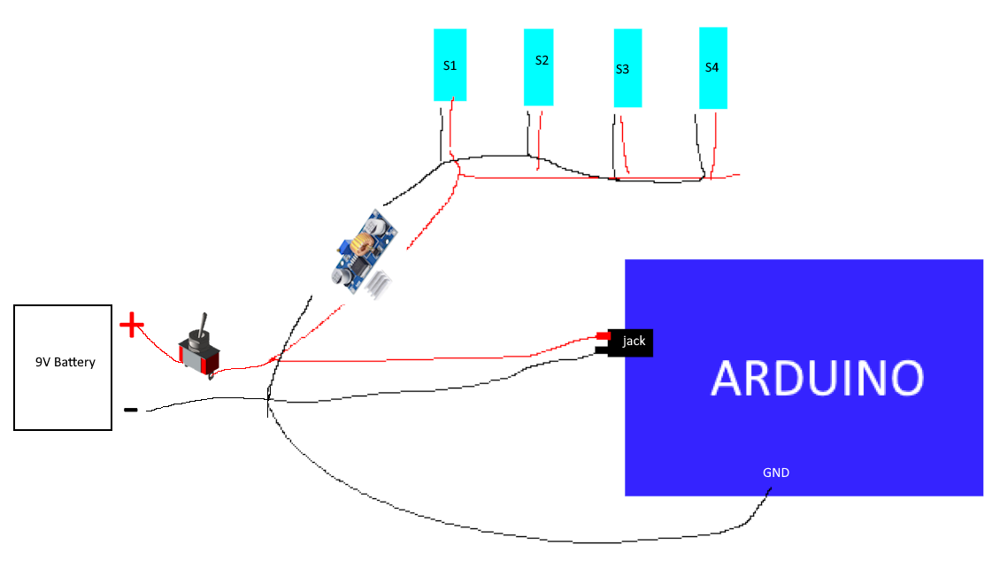
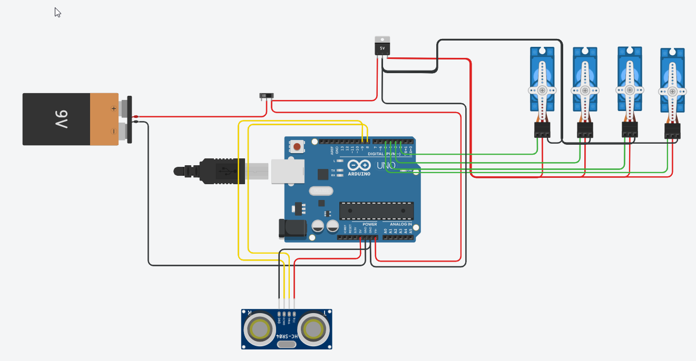

# Boxy

Boxy est un robot Arduino qui utilise 4 servomoteurs pour piloter deux jambes. L'objectif est la création d'un robot autonome, uniquement équipé d'un capteur à ultrasons pour mesurer la distance entre lui et l'obstacle en face de lui, afin de choisir une direction pour l'éviter et poursuivre son chemin.

## Composants électroniques
- Capteur à ultrasons : HC-SR04
- Batterie 9V : 6 piles AA de 1,5V
- Servomoteurs 9G : SG90
- Arduino : Arduino Uno R3
- Régulateur de tension : XL4015 DC-DC Buck Converter

## Fichiers
Vous trouverez dans le dépôt tous les fichiers .stl pour imprimer les pièces, ainsi que deux schémas électroniques (l'un sur Tinkercad, l'autre sur Paint) pour illustrer le montage avec précision.

## Schémas

</img>
</img>

# Aperçu 3D

Vous trouverez ci-dessous des aperçus du robot finale assemblé :

